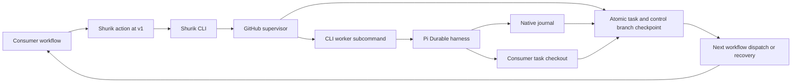

# Shurik architecture

Shurik is a CLI distributed with a reusable GitHub Action. A consumer repository supplies a prompt, optional configuration, and three small workflows referencing `igor-makarov/shurik@v1`. The action invokes the CLI; the CLI supervises a Pi Durable worker and publishes task changes and sessions back to the consumer repository.

## Components



| Component | Implementation | Role |
| --- | --- | --- |
| Public action | `action.yml`, `action/run.mjs` | Set up Node, resolve the current action release, invoke CLI with consumer inputs |
| CLI | `bin/shurik.mjs` | Parse commands/flags, route lifecycle operations, run or inspect native workers, print session paths |
| Supervisor | `scripts/supervisor.mjs` | Authorize starts/control, fence owners, enforce budgets/stops, publish PRs and dispatch successors |
| Git/control store | `scripts/github.mjs`, `scripts/state.mjs` | GitHub API, compare-and-swap control updates, atomic two-branch checkpoints, state hydration |
| Runtime | `scripts/runtime.mjs` | Build engine separately, launch worker process group, handle cooperative checkpoints and shutdown |
| Pi Durable worker | `src/worker.ts`, `src/cli.ts` | Native JSONL storage, fresh context, model requests, coding/history tools; `src/cli.ts` is the private bundle entry |
| History and checkpoints | `src/history.ts`, `src/checkpoint.ts` | Bounded prior-session retrieval, serialized journal snapshots, continuation instructions |
| Failure recovery | `scripts/failures.mjs`, `scripts/policy.mjs` | Immutable diagnostics, trusted run identity, cancellation and generation fencing |
| Consumer contract | `scripts/config.mjs`, `scripts/paths.mjs` | Project-owned configuration and canonical layout version 1 |

The CLI supervisor uses Node built-ins. It does not import Pi Durable or consumer code into the supervisor process. Pi Durable and its pinned dependencies are bundled into `dist/worker.cjs`, run as a child through `shurik worker --request FILE`. A broken worker import therefore leaves the supervisor able to preserve diagnostics.

## Release and repository boundaries

Each invocation uses the current release under the workflow's major action reference (`@v1`, later `@v2`). A loop has no frozen engine revision: compatible updates can arrive between iterations. Record the actual engine commit in iteration diagnostics so failures can be traced. The release contract requires same-major compatibility for action inputs, dispatch fields, configuration, and native journal/session state.

The action fetches engine source into a temporary checkout outside the task checkout. Builds use the engine's package lock. Consumer code is cloned separately from the consumer's source/work branch. Consumer repositories do not need Shurik source, a package.json, or any Shurik dependencies. Model, prompt, checkpoint interval, and ignored task snapshot selections come from the consumer, not the engine checkout.

Both work and control branches are created in the consumer repository. The action repository receives no task code or journals. `GITHUB_WORKSPACE` is the initial consumer checkout; coding tools start in the separate task clone. Temporary engine/build directories have no persistence role.

Legacy self-hosted loops used immutable supervisor source references and validated candidate/fallback runner revisions. The existing helpers and runner proof retain that behavior. Shurik's own iteration workflow recognizes a legacy checkout without `action.yml` and invokes its original supervisor. New reusable loops use the current release and do not promote consumer source into the engine. Legacy state is not silently migrated.

## CLI and workflow contract

The public commands are `start`, `iterate`, `stop`, `resume`, `recover`, `worker`, `inspect`, and `paths`. The action exposes the first five. Its optional JSON `inputs` adapter passes dispatch fields without shell interpolation; individual action inputs and CLI flags can override them.

`ralph.yml` dispatches `start` or `iterate`. `control.yml` dispatches `stop` or `resume`. `recover.yml` wakes after worker completion and every 15 minutes. See the [complete consumer workflows](examples/consumer/.github/workflows). Recovery expects the workflow name `Shurik Ralph`, the run-title format `Ralph <loop-id> / <command> <generation>-<iteration>`, first-party repository identity, and a default-branch workflow dispatch. The iteration filename is recorded in control and can be changed using the `workflow` input.

The built-in GitHub token has contents/PR/Actions write permissions for the consumer worker job. Start and control check the dispatch actor's repository write permission. Secrets stay in Actions inputs/environment and do not enter command-line arguments. Fork contributor CI remains read-only and receives no model key.

## Iteration lifecycle

1. `start` checks authorization, reasoning, budget, deadline, consumer source, prompt, and configuration. It initializes `codex/shurik/<id>` and `codex/shurik-control/<id>` with a paired checkpoint, then dispatches iteration 1.
2. `iterate` reads authoritative control and claims the expected generation/iteration. Stale, duplicate, stopped, or expired invocations do not start an agent.
3. Clone the consumer work branch and hydrate canonical session state from its control branch. Import failure evidence and mark unfinished sessions as interrupted. Save an iteration-start record.
4. Build the current engine separately. Run the worker with the consumer working directory, journal path, bounded budget, explicit reasoning, prompt, and history index.
5. Pi Durable aborts pending historical work and resets to a fresh model context. Publish the native session boundary before the first model request. History tools retrieve older transcript ranges on demand.
6. At completed tool-round boundaries, the Pi hook serializes a journal copy and waits for the supervisor to publish source, journal, session boundaries, index, and available output together. No process freeze is used for checkpoints.
7. At yield, failure, or timeout, abort the worker and preserve partial code and diagnostics. Inspect journals on disposable copies; retain malformed data and restore the last readable snapshot if necessary.
8. Publish the final paired checkpoint, create/update the draft PR when there are task changes, release ownership, and re-read stop/deadline/generation state before dispatching a successor.

A model final response ends an iteration, not the outer loop. A stop or deadline is authoritative. Ordinary progress feedback encourages continuing useful work; clock/countdown/handoff instructions appear only within the last checkpoint interval before preemption.

## Canonical persistence contract

`PATHS` and `runtimeState()` in [scripts/paths.mjs](scripts/paths.mjs) are the shared declaration of layout version 1. `shurik paths --loop-id ID --workspace DIR` exposes the resolved mapping.

```text
Consumer task checkout                 Consumer control branch
                                      codex/shurik-control/<id>
.shurik-local/state/<id>/              state/
  pi-jsonl/                             pi-jsonl/
  history-index.json                    history-index.json
  loop.json                             loop.json
  runtime.json                          runtime.json
  iterations/<generation>-<n>.json       iterations/<generation>-<n>.json
  diagnostics/                          diagnostics/
    recovery/<run>-<attempt>.json          recovery/<run>-<attempt>.json
  task-files/                           task-files/
  task-files.json                       task-files.json
                                      control.json
                                      failures/<run>-<attempt>.json
```

Native `pi-jsonl/` is the complete Pi Durable directory, including its native sidecars; Shurik does not replace it with a custom transcript format. `history-index.json` indexes stable iteration IDs and published transcript bounds. `loop.json` is task-facing identity/progress metadata; scheduling and deadlines belong to authoritative `control.json`. `runtime.json` retains engine diagnostic fields and legacy candidate/fallback metadata.

Checkpoint publication copies the complete runtime session root to control-branch `state/`, optionally replacing the live journal with the independent serialized snapshot. `control.json.checkpoint.workCommit` identifies the paired work commit. Git `push --atomic` publishes both refs; a conflict publishes neither. Control compare-and-swap retries re-read the latest generation/owner and preserve racing stop/resume decisions. The next run restores `state/` to `.shurik-local/state/<id>/` before launching the worker. These files are excluded through `.git/info/exclude` and removed from the task index even if an agent stages them.

`checkpointPaths` explicitly selects ignored consumer data. Its snapshot is saved under `task-files/`, with the paired commit recorded in `task-files.json`. Restore fills missing files; newer tracked data stays authoritative. Detached background writers need their own coordination because the cooperative hook only stabilizes foreground tool rounds.

Recovery commits immutable reports to `failures/<run-id>-<attempt>.json` and indexes them in `control.json.failureTrail` before advancing an interrupted owner or retrying dispatch. Later workers import them under `diagnostics/recovery/`. Reports retain bounded redacted log excerpts and mark missing or truncated diagnostics.

## Operational limits and verification

The worker shares the Actions runner and job credentials. Separate checkouts isolate engine selection from task files operationally; they are not a security sandbox. Sessions follow the consumer repository's visibility. Redaction reduces accidental credential publication, with the limits documented in [README.md](README.md#caveats).

Forced cancellation or host loss can discard unpublished work. `.shurik-emergency/` in the initial consumer checkout is an optional failure artifact, never a trusted automatic recovery input. Git state is canonical. Recovery can retain available Actions logs but cannot reconstruct an unpublished journal.

`npm run verify` checks types, bundles, native journals, provider configuration, checkpoint races, recovery, and an unrelated consumer with no engine source. `node tests/runner-proof.mjs` exercises the retained legacy self-repair path. Release checks must keep earlier same-major journals readable; incompatible migrations belong in a new major version.
