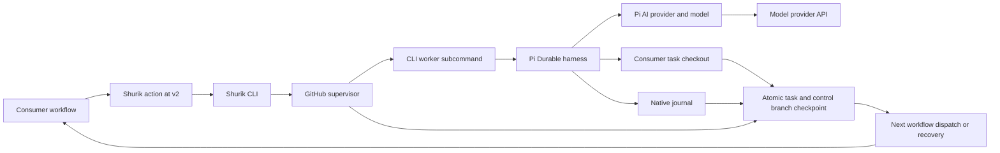

# Shurik architecture

Shurik is a CLI distributed with a reusable GitHub Action. A consumer repository supplies a prompt, optional configuration, and one workflow referencing `igor-makarov/shurik@v2`. The action invokes the CLI; the CLI supervises a Pi Durable worker and publishes task changes and sessions back to the consumer repository.

## Components



| Component | Implementation | Role |
| --- | --- | --- |
| Public action | `action.yml`, `action/run.ts` | Set up Node, resolve the current action release, invoke CLI with consumer inputs |
| CLI | `bin/shurik.ts` | Parse commands/flags, route lifecycle operations, run or inspect native workers, print session paths |
| Supervisor | `scripts/supervisor.ts` | Authorize starts/control, fence owners, enforce budgets/stops, publish PRs and dispatch successors |
| Git/control store | `scripts/github.ts`, `scripts/state.ts` | GitHub API, compare-and-swap control updates, atomic two-branch checkpoints, state hydration |
| Runtime | `scripts/runtime.ts` | Build engine separately, launch worker process group, handle cooperative checkpoints and shutdown |
| Pi Durable worker | `src/worker.ts`, `src/cli.ts` | Native JSONL storage, fresh context, model requests, coding/history tools; `src/cli.ts` is the private bundle entry |
| Model access | Pi AI `Models` collection and provider adapters | Model catalogs, provider protocols, authentication, thinking-level capabilities |
| History and checkpoints | `src/history.ts`, `src/checkpoint.ts` | Bounded prior-session retrieval, serialized journal snapshots, continuation instructions |
| Failure recovery | `scripts/failures.ts`, `scripts/policy.ts` | Immutable diagnostics, trusted run identity, cancellation and generation fencing |
| Consumer contract | `scripts/config.ts`, `scripts/paths.ts` | Action configuration and canonical persisted layout version 1 |

All authored code is TypeScript: the CLI, action entry point, supervisor, worker, tests, test helpers, and native runner proof. Node 24 executes the CLI and orchestration through built-in type stripping; `tsc --noEmit` checks production modules and every test/helper. The CLI supervisor uses Node built-ins. It does not import Pi Durable or consumer code into the supervisor process. Pi Durable and its pinned dependencies are bundled into `dist/worker.cjs`, run as a child through `shurik worker --request FILE`. A broken worker import therefore leaves the supervisor able to preserve diagnostics.

## Model providers

[Pi Durable](https://github.com/earendil-works/pi/blob/main/packages/durable/README.md#quick-start) receives a Pi AI `Models` collection when its harness opens. The host registers provider adapters and configures a conversation with `{ provider, modelId }` plus a thinking level. Pi AI routes requests through the selected adapter, which supplies its catalog, wire protocol, and authentication. Provider choice is independent of durable storage, history tools, Git checkpoints, and GitHub dispatch/recovery.

[Pi AI's provider layer](https://github.com/earendil-works/pi/blob/main/packages/ai/README.md#providers-and-models) supports individual provider factories or a collection of all built-in providers. Its [authentication layer](https://github.com/earendil-works/pi/blob/main/packages/ai/README.md#auth) resolves provider credentials from supported environment variables, credential stores, OAuth, or ambient cloud configuration. Custom compatible endpoints require a registered custom provider with its own model metadata and authentication.

The worker pins Pi Durable, Chord, and Pi AI to `1.2.0` and uses Pi AI's `builtinModels()` collection. The public structured `model` object is resolved into flat `provider`, `model`, and `reasoning` fields in authoritative `control.json`, task-facing loop metadata, iteration diagnostics, and worker requests. Conversations receive that exact pair and explicit reasoning. Known models retain strict reasoning validation. `registerUnlistedModel()` supplies a provisional descriptor for a custom ID through an existing provider's native transport; OpenCode uses the OpenAI-compatible chat endpoint. The descriptor preserves the requested reasoning level, forwards text and image input for the provider to validate, uses the provider template's context/output limits, and carries no inferred prices or model-specific sampling settings. The provider's auth and streaming functions remain unchanged. Provider rejections follow Pi Durable's normal agent-failure path and do not quarantine the engine or select an alternate model. There is no catalog fetch, cache, or configuration directory. Scripted and inspect modes stay network-free; results mark provisional metadata so zero estimates cannot be mistaken for known pricing.

Pi Durable `1.2.0`'s unmodified `CodingTools` extension provides native image reading. `read` returns an `ImageContent` block for PNG, JPEG, GIF, and WebP within the selected model's `inputLimits.images.resize`, defaulting to 2000×2000 pixels and 4.5 MiB of base64. No image processor is configured; oversized images and BMP return diagnostics rather than truncated attachments. Pi AI performs native provider serialization, including its placeholder for listed text-only models. The image block is retained in the native journal and copied with checkpoints. History tools use the new `ToolExecutionResult.output` field; persisted transcript messages still use native `content`. Existing version-1 session/control paths and old journals remain compatible, including interrupted version-1 tool tasks, which Shurik aborts before fresh input.

Resume retains the saved pair or atomically changes it with the new generation; a provider change requires an explicit model. Missing provider fields in older version-1 controls and worker requests mean `opencode-go`, preserving same-major compatibility. Journal inspection does not resolve a provider or require authentication.

The iteration action inherits native provider environment variables and cloud configuration. Pi AI resolves authentication; Shurik supplies no per-request API-key override, interactive login flow, or persistent credential store. The existing `opencode-api-key` input remains an optional environment alias. Credentials never become action configuration, worker-request JSON, or saved control fields. Publication redaction includes provider key/token variables and cloud credentials present in the environment. Bundled metadata comes from the installed Pi AI package; unlisted IDs use provisional metadata. Additional custom endpoints need an adapter integration.

## Release and repository boundaries

Each invocation uses the current release under the workflow's major action reference (`@v2` for the current interface). A loop has no frozen engine revision: compatible updates can arrive between iterations. Record the actual engine commit in iteration diagnostics so failures can be traced. The release contract requires same-major compatibility for action inputs, dispatch fields, configuration, and native journal/session state.

The action fetches engine source into a temporary checkout outside the task checkout. Builds use the engine's package lock. Consumer code is cloned separately from the consumer's source/work branch. At initialization, workflow definitions come from the default branch even when `source_ref` selects older task source, because the Actions token cannot introduce other workflow versions on new branches. Consumer repositories do not need Shurik source, a package.json, or any Shurik dependencies. Model, prompt, checkpoint interval, and ignored task snapshot selections come from the consumer, not the engine checkout.

Start receives structured model and optional swarm configuration through action/CLI inputs. The built-in launch resolver merges overrides, checks cardinality and loop IDs, and validates common settings before creating remote state. A single control job then runs the existing per-loop initialization path for every member. Each member saves its effective settings in its own `control.json`. Swarm identity (prefix, zero-based index, agent count) is persisted in control and loop metadata and included in the iteration prompt. There is no shared agent runtime or communication transport. Iteration and recovery invocations read that record; continuation dispatches only need the loop identity and fence. No project config file is written. Version 2 ignores `.shurik/config.json`; all operational defaults live in the engine.

Both work and control branches are created in the consumer repository. The action repository receives no task code or journals. `GITHUB_WORKSPACE` is the initial consumer checkout; coding tools start in the separate task clone. Temporary engine/build directories have no persistence role.

Legacy self-hosted loops used immutable supervisor source references and validated candidate/fallback runner revisions. The existing helpers and runner proof retain that behavior. New reusable loops use the current release and do not promote consumer source into the engine. Legacy state is not silently migrated.

## CLI and workflow contract

The public commands are `start`, `iterate`, `stop`, `resume`, `recover`, `worker`, `inspect`, and `paths`. The action exposes the first five. Its optional JSON `inputs` adapter passes dispatch fields without shell interpolation; individual action inputs and CLI flags can override them.

[`shurik.yml`](examples/consumer/.github/workflows/shurik.yml) is the only consumer workflow:

- `control` handles `start`, `stop`, and `resume`, with its own concurrency group so stops do not wait for a worker.
- `iteration` handles the internal `iterate` dispatch and runs the Pi Durable worker with the model secret.
- `recovery` depends on both jobs and uses `always()`. On iteration completion it verifies the first-party default-branch workflow identity and GitHub's completed `iteration` job, using that job's result while the overall run is still in progress. It preserves failure evidence and reconciles a stranded owner or a failure before claim. A 15-minute schedule in the same workflow recovers when the entire workflow was interrupted.

Recovery identifies the workflow name `Shurik`, job name `iteration`, and iteration run title `Shurik <loop-id> / <n>`. Control run titles are `Shurik <loop-id> / start|stop|resume`, and scheduled runs are `Shurik recovery`. Dispatches request GitHub's `return_run_details` response and append `{ runId, generation, iteration }` to `control.json.dispatchedRuns`. Recovery resolves the internal generation through that exact run ID, or current claimed ownership if the run starts before its dispatch receipt is saved. It never infers a generation from a continuous iteration number alone. Earlier `Shurik <loop-id> / iterate <n>` titles also resolve through their saved run IDs. Already queued runs with legacy `Shurik`/`Ralph` generation-number titles remain readable, as do legacy `Shurik Ralph` workflow names. The dispatch filename is recorded in control; the default is `shurik.yml`.

The built-in GitHub token has contents/PR/Actions write permissions for the consumer worker job. Start and control check the dispatch actor's repository write permission. Secrets stay in Actions inputs/environment and do not enter command-line arguments. Fork contributor CI remains read-only and receives no model key.

`create-pr` is an optional action/CLI setting; the workflow adapter calls it `create_pr`. The default `auto` attempts a draft PR when task changes exist. Successful creation records `createPr: true`; GitHub's specific repository-setting denial records `createPr: false` and continues. Explicit `false` skips PR API calls, while `true` enables an attempt. Other API errors retain the normal failure/recovery behavior. The durable control field is carried across iterations and can be changed on resume; `auto` retries permission discovery after repository settings change. Permission discovery uses the normal PR request and does not require an administration token.

The worker enables only provider request retries: `stream.maxRetries: 3`, `stream.maxRetryDelayMs: 60000`, and `stream.timeoutMs: 120000`. Pi Durable's separate `retry` policy remains disabled with zero retries. Native adapters handle supported temporary HTTP/network failures and provider wait headers; waits longer than the cap fail immediately rather than being shortened, and waits remain cancellable by the iteration budget. Failed model responses are not retried by the harness. Exhaustion retains `agent_failure` and its nonzero exit status, leaving continuation to recovery. No public retry configuration or custom retry loop is added.

## Iteration lifecycle

1. `start` resolves its model object or swarm members, then checks authorization, explicit model/reasoning configuration, budget, deadline, consumer source, and prompt for each loop. The task branch is exactly `<id>` and the control branch is `shurik-control/<id>`. An existing task branch uses its current remote tip; a new branch uses the consumer checkout or explicit source. A different explicit source is rejected for an existing task branch. Existing loop control requires resume. Initialization publishes a paired checkpoint without inventing a task commit, then dispatches iteration 1.
2. `iterate` reads authoritative control and claims the expected generation/iteration. Stale, duplicate, stopped, or expired invocations do not start an agent.
3. Clone the consumer work branch and hydrate canonical session state from its control branch. Import failure evidence and mark unfinished sessions as interrupted. Save an iteration-start record.
4. Build the current engine separately. Run the worker with the saved provider/model pair, consumer working directory, journal path, bounded budget, explicit reasoning, prompt, and history index.
5. Pi Durable aborts pending historical work and resets to a fresh model context. Publish the native session boundary before the first model request. History tools retrieve older transcript ranges on demand.
6. At completed tool-round boundaries, the Pi hook serializes a journal copy and waits for the supervisor to publish source, journal, session boundaries, index, and available output together. `checkpoint-seconds: 0` skips all worker checkpoint handshakes and disables automatic task commits at every boundary, including initialization, iteration start and finalization. Session/control persistence continues against the current task HEAD, and atomic publication pushes only existing agent commits without staging unfinished edits. A source requiring workflow synchronization is rejected at startup in this mode. Start persists this setting for every swarm member; resume can override it or retain the saved interval. No process freeze is used for checkpoints.
7. At yield, failure, or timeout, abort the worker and preserve partial code and diagnostics. Inspect journals on disposable copies; retain malformed data and restore the last readable snapshot if necessary.
8. Publish the final paired checkpoint, create/update a draft PR when repository settings allow it (otherwise retain the task branch), release ownership, and advance the iteration number. Successful iterations dispatch a successor or save their wait time and return zero. Failed iterations leave no dispatch reservation and return nonzero; recovery schedules their successor using the saved control state. Stop/deadline/generation state remains authoritative. When the loop ID is the default branch name, such as `main`, checkpoints go directly to that branch and PR creation is always disabled at start, resume, and publication.

CLI and standalone-worker exit codes are zero for normal completion or work-budget expiry, two for inference failure, and one for runner/configuration/control errors. An exit-two worker result must report `agent_failure`; mismatched or abnormal worker exits remain `runner_failure`. Older worker reports using exit zero retain their structured outcome. The action propagates the public CLI status. Reporting a saved inference failure does not enter the supervisor exception handler or create an emergency snapshot.

Iteration numbers are continuous across generations: after iteration 5, a stop/resume starts iteration 6. Resume advances past any claimed interrupted owner; an unclaimed queued successor keeps its number. Reconciliation of a stopped/cancelled owner also advances the counter before clearing ownership, so recovery and resume cannot reuse an iteration that started. The internal generation changes on resume and remains in dispatch inputs, ownership fences, and persisted session IDs (`<generation>-<n>`), but is absent from run titles. Saved run IDs distinguish old and current queued runs that share a title.

`work-seconds` configures the work budget (10–1800); `wait-seconds` configures a nonnegative idle interval and defaults to zero. Both settings persist in `control.json`. The work budget keeps its version-1 `seconds` storage field for compatibility; `waitSeconds` and `nextRunAt` are additive. Older records without them continue immediately. Public action/CLI `seconds` remains a deprecated alias, while templates and named inputs use `work-seconds`.

Finalization releases ownership, advances the contiguous iteration number, and either dispatches immediately or saves `nextRunAt` measured from completion of iteration cleanup. A waiting loop retains `status: running`, with no owner or outstanding dispatch reservation. Waiting is scheduler metadata and stays out of task-facing `loop.json`. A future due time blocks both dispatch and iteration claims. The existing recovery schedule wakes due loops with the same workflow. It reserves dispatch inside control CAS, checks the generation/iteration and dispatch grace period on every retry, and rechecks current control before the GitHub request. Racing scheduled checks cannot each dispatch the slot. No sleeping process or runner spans the wait.

Recovery of an interrupted owner measures the wait from GitHub's completed iteration job timestamp, or completed run timestamp when recovering the entire workflow. Repeated checks never extend the saved due time. Failure before claim does not consume a number or restart the wait. Stop/cancellation and deadlines clear scheduled eligibility. Resume of a waiting loop immediately clears the due time, changes generation, retains or replaces work/wait settings, and dispatches the same next number. Existing stop/resume fences prevent old queued jobs or an older recovery observation from reviving the prior generation. Workflow summaries expose waiting and the due timestamp.

A model final response ends an iteration, not the outer loop. A stop or deadline is authoritative. Ordinary progress feedback encourages continuing useful work; clock/countdown/handoff instructions appear only within the last checkpoint interval before preemption.

## Canonical persistence contract

`PATHS` and `runtimeState()` in [scripts/paths.ts](scripts/paths.ts) are the shared declaration of layout version 1. `shurik paths --repository OWNER/REPO --loop-id ID --workspace DIR` exposes the resolved mapping.

```text
Runtime under $HOME/.shurik/                Consumer control branch
                                           shurik-control/<id>
state/<owner>/<repo>/<id>/                  state/
  pi-jsonl/sessions/<generation>-<n>/          pi-jsonl/sessions/<generation>-<n>/
  history-index.json                         history-index.json
  loop.json                                  loop.json
  runtime.json                               runtime.json
  iterations/<generation>-<n>.json            iterations/<generation>-<n>.json
  task-files/                                task-files/
  task-files.json                            task-files.json
logs/<owner>/<repo>/<id>/                   state/diagnostics/
  recovery/<run>-<attempt>.json               recovery/<run>-<attempt>.json
emergency/<owner>/<repo>/<id>/<run>-<attempt>/  (Actions artifact only)
  workspace/, state/, logs/
                                           control.json (control and configuration)
                                           failures/<run>-<attempt>.json
```

Each new iteration opens a complete native Pi Durable directory under `pi-jsonl/sessions/<generation>-<n>/`, including `main.jsonl` and the native sidecars. Finished journals stop growing; a later iteration never appends to them. `history-index.json` and iteration records retain a `journalId` alongside published transcript bounds because entry IDs are local to a journal. History tools open historical storage lazily on disposable copies, without starting a harness or replaying pending work. The legacy shared journal remains directly under `pi-jsonl/`; records without a `journalId` resolve there. This additive layout keeps old histories readable without rewriting their native journals. Shurik does not replace Pi Durable's transcript format. `loop.json` is task-facing identity/progress metadata; scheduling and deadlines belong to authoritative `control.json`. `runtime.json` retains engine diagnostic fields and legacy candidate/fallback metadata.

Earlier loops keep their saved branch names. Control lookup first tries the canonical ref and falls back to the earlier control prefix; recovery enumerates both and deduplicates loop IDs. A new start rejects an ID that already has either control ref. The task branch is read from the saved control, so existing loops continue without changing their journals or renaming branches. New IDs reserve `shurik-control` to prevent a task branch from colliding with the control namespace.

Checkpoint publication copies the runtime session root to control-branch `state/` and runtime `logs/` to `state/diagnostics/`, optionally replacing only the active session's journal with the independent serialized snapshot. `control.json.checkpoint.workCommit` identifies the paired work commit. Git `push --atomic` publishes both refs; a conflict publishes neither. Control compare-and-swap retries re-read the latest generation/owner and preserve racing stop/resume decisions. The next run restores `state/` to `$HOME/.shurik/state/<owner>/<repo>/<id>/` and moves its `diagnostics/` into `$HOME/.shurik/logs/<owner>/<repo>/<id>/` before launching the worker. The persisted layout remains version 1, so existing journals and diagnostics need no control-branch migration. The runtime root is outside the task checkout and needs no Git exclusion. `SHURIK_HOME` optionally overrides `$HOME/.shurik`. Redaction scans the task checkout, external session root, and logs before publication.

`checkpointPaths` explicitly selects ignored consumer data. Its snapshot is saved under `task-files/`, with the paired commit recorded in `task-files.json`. Restore fills missing files; newer tracked data stays authoritative. Detached background writers need their own coordination because the cooperative hook only stabilizes foreground tool rounds.

Recovery commits immutable reports to `failures/<run-id>-<attempt>.json` and indexes them in `control.json.failureTrail` before advancing an interrupted owner or retrying dispatch. Later workers import them under runtime `logs/<owner>/<repo>/<id>/recovery/`; checkpoints retain that evidence at `state/diagnostics/recovery/`. Reports retain bounded redacted log excerpts and mark missing or truncated diagnostics.

## Operational limits and verification

The worker shares the Actions runner and job credentials. Separate checkouts isolate engine selection from task files operationally; they are not a security sandbox. Sessions follow the consumer repository's visibility. Redaction reduces accidental credential publication, with the limits documented in [README.md](README.md#caveats).

Forced cancellation or host loss can discard unpublished work. `$HOME/.shurik/emergency/<owner>/<repo>/<id>/<run>-<attempt>/` preserves task files, session state, and logs in separate `workspace/`, `state/`, and `logs/` directories. Both control and iteration jobs can upload it through the action's `emergency-path` output after failure. It is an optional failure artifact, never a trusted automatic recovery input. All runtime directories are outside checkouts and require no Git exclusions. Git state is canonical. Recovery can retain available Actions logs but cannot reconstruct an unpublished journal.

`npm run verify` checks types, bundles, native journals, provider configuration, checkpoint races, recovery, and an unrelated consumer with no engine source. `node tests/runner-proof.ts` exercises the retained legacy self-repair path. Release checks must keep earlier same-major journals readable; incompatible migrations belong in a new major version.

## Version 2 input boundary

`Inputs` describes public model/swarm objects (or JSON strings), and `Options` describes resolved flat per-loop settings. `scripts/launch.ts` is the single resolver used by action/CLI startup and resume. Neither parsing nor swarm expansion imports Pi into the supervisor. The `swarm` input is start-only; stop/resume address individual loop IDs. Resume resolves optional model overrides against the saved selection and retains existing generation and ownership fencing. Internal continuation dispatches carry only the loop ID, generation and iteration; they do not carry model configuration.

Swarm startup is sequential because the current supervisor owns per-invocation emergency bookkeeping. Every failed member preserves its own emergency evidence before proceeding; action outputs enumerate all member emergency paths for the single upload step. All structural model inputs and common settings are validated before startup, and a control-ref preflight catches existing swarm IDs. Network failures and races can still cause partial startup; there is no cross-loop transaction.

The v2 workflow removes separate provider/reasoning inputs and model fallback expressions. Existing v1 action tags remain unchanged. Persisted control, checkpoint, history and worker-request layouts remain readable; see [migration](MIGRATION.md).
